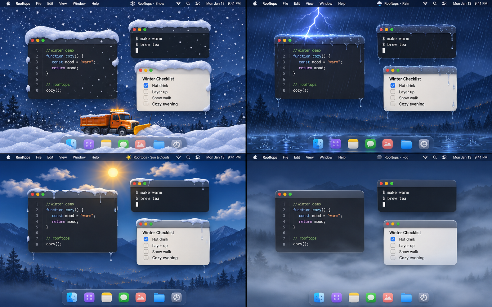

# Rooftops



<sub>AI-generated illustration of the four weather modes; the app's actual drawing is simpler.</sub>

A tiny macOS menu-bar app that brings the weather to your desktop: snow, rain with lightning, sun and
clouds, or fog, or whatever it's like outside right now. Windows behave like houses: snow piles up on their
roofs (the title bars), sticks to their walls, slides off when you move them, and drifts up at the bottom of
the screen; rain drips off them and puddles below. Tilt your MacBook and everything follows gravity. When the
snow gets too deep, the snowplows come.

One Swift file, no dependencies, no Xcode project.

## Features

- **Falling snow** over the desktop, with flakes of different sizes (smaller ones are dimmer and slower,
  so they read as farther away).
- **Windows are houses**
  - snow settles on the top edge of every window and slides off the sides at the angle of repose;
  - it never falls in front of an app: flakes that hit a side wall stop and slide down it, and some of
    them stay plastered to the wall, slowly creeping down and dropping off over time;
  - about 30% of the snow falls *behind* the windows, so the ground under a window gets a thinner layer
    than open ground;
  - snow on a window hidden by another one is clipped exactly at the edge of the window in front;
  - move or resize a window and its snow falls off (and lands back on it if you only nudged it); close it
    and the snow drops to the ground;
  - snow is kept for windows on another Space or minimized, and comes back with them.
- **Ground drifts** at the bottom of the screen, which pile up against the screen edges. Once a quarter of
  the screen width has snow higher than half the Dock (a single drift isn't enough), a single snowplow sets
  off on its own and lowers all of it to a quarter of the Dock in one pass; if that much builds up again
  behind it (say, in a blizzard) another truck follows. This can be switched off from the menu.
- **Gravity from the laptop's tilt** (Apple Silicon MacBooks): flakes fall at an angle, settled snow slides
  downhill, and once the slope beats friction a whole roof of snow slides off as a slab and is thrown off
  the edge.
- **Blizzard**: 15 seconds of heavy snow with random gusts. Windows shelter the air behind them, and wind
  blows snow in from the side of the screen it comes from.
- **Snowplows**: the automatic one is a single truck that lowers the snow (see above). Calling it from the
  menu sends a convoy that clears the road: one truck per ~32 pt layer of snow, up to 10, each scraping one
  layer and riding on the packed snow it leaves. Trucks tilt on slopes and push a heap that rests on the snow
  ahead like real snow; what doesn't fit is thrown over the blade.
- **Rain mode**: switch from snow to rain in the menu. Drops fall as fast streaks and splash instead of
  piling up; water runs off the window roofs and drips from their corners, trickles down walls it hits, and
  collects in a puddle at the bottom that stays level with real gravity, so tilting the laptop sends it to the
  lower side. Rain melts whatever snow is there. In rain mode the blizzard becomes a thunderstorm, with lightning
  every couple of seconds; heavy rain brings lightning too, more often the harder it rains: a forked bolt hits the first thing below
  it, a window roof or the ground, with sparks, and the sky flashes behind the windows.
- **Sun mode**: the sun crosses the sky with the local time (the moon at night), clouds drift by on a breeze,
  and the slider sets how cloudy it is. Sunshine melts the snow (less under clouds, hardly at night): roofs drip
  and the puddle dries up.
- **Fog mode**: banks of fog flow past at different speeds over a haze that thickens toward the ground; the
  slider sets how thick it is.
- **Automatic weather**: shows the weather where you are, refreshed every 15 minutes: clear or cloudy skies
  become sun mode with the real cloud cover, fog becomes fog, drizzle, rain and showers become rain (a
  thunderstorm brings lightning), snow becomes snow, each as strong as it really is.
- **Multiple displays**: snow on the main screen only, or on all screens. External monitors don't tilt.

## Requirements

- macOS on Apple Silicon (developed and tested on an M-series MacBook running macOS 27).
- Swift toolchain (Xcode or the Command Line Tools) — `swiftc` is all the build needs.
- Tilt needs the built-in accelerometer of Apple Silicon MacBooks. On other Macs the app works the same,
  with snow falling straight down.

## Build and run

```sh
./build.sh          # compiles Rooftops.swift into Rooftops.app and ad-hoc signs it
open Rooftops.app
```

The app has no Dock icon: look for the snowflake in the menu bar (it follows the weather: rain cloud, sun, fog).

To check the snow physics (piles, avalanches, slab slides):

```sh
Rooftops.app/Contents/MacOS/Rooftops --selftest
```

## Menu

The menu is in Italian:

| Section   | Item                      | What it does                                                         |
|-----------|---------------------------|----------------------------------------------------------------------|
| Meteo     | Automatico                | Follows the weather where you are (remembered); the mode it picked is marked with a dash |
|           | Neve / Pioggia / Sole / Nebbia | Snow, rain, sun and clouds, or fog (remembered; leaves automatic mode) |
| Intensità | slider                    | How hard it snows or rains, how cloudy the sunny sky is, how thick the fog is (set by the real weather, and greyed out, in automatic mode) |
| Neve      | Tormenta di neve (⌘T)     | Switches to snow and starts a 15 s blizzard with random gusts        |
|           | Chiama lo spazzaneve (⌘P) | Sends the snowplow convoy now                                        |
|           | Spazzaneve automatico     | Snowplows set off on their own to keep the ground snow low (remembered, on by default) |
| Pioggia   | Temporale (⌘Y)            | Switches to rain and starts a 15 s thunderstorm with gusts and lightning |
| —         | Tutti gli schermi         | Snow or rain on every display instead of the main one only (remembered) |
| —         | Inverti inclinazione      | Flips the tilt direction if the snow slides the wrong way            |
| —         | Esci (⌘Q)                 | Quits and switches the accelerometer back off                        |

## How it works

- **Overlay**: one transparent, click-through, borderless window per screen, just above the Dock, on all
  Spaces. Everything is drawn with Core Graphics at 30 fps.
- **Windows**: the app polls `CGWindowListCopyWindowInfo` about 10 times a second for the bounds of
  on-screen windows. It only reads their position and size, so no Screen Recording permission is needed.
- **Settled snow** is a heightmap with 2 pt columns: one for the ground and one per window roof. Each flake
  adds its own volume when it lands, and a simple angle-of-repose relaxation lets piles slump, slide with
  the tilt, and spill over roof edges.
- **Slab slides** use static and kinetic friction, so snow holds on gentle slopes and slides off as a whole
  layer on steep ones.
- **Accelerometer**: Apple Silicon MacBooks expose the motion sensor as a vendor HID device
  (`AppleSPUHIDDriver`, usage page `0xFF00`, usage `3`). The app enables only that sensor at 50 Hz, reads its
  sideways axis, and switches it off again on quit. This is undocumented hardware access and might change
  with future macOS versions.

## Privacy

The app only reads the position and size of your windows, never their content, and needs no Screen
Recording permission. Nothing leaves your Mac unless you turn on automatic weather: then macOS asks for
Location Services, and every 15 minutes your coordinates, rounded to about 10 km, are sent to
[Open-Meteo](https://open-meteo.com) (free, no account or API key) to get the current weather there.

## Tuning

The values that define the feel of the snow are marked in the source with `ponytail:` comments:

| What                         | Where to look                          |
|------------------------------|----------------------------------------|
| How fast snow piles up       | `0.6 = fluffiness` in `Pile.add`       |
| Friction of sliding slabs    | `μ static 0.4` in `Pile.slide`         |
| Fall speed of heavy clumps   | `1400 pt/s²` in `SnowView.step`        |
| Blizzard duration            | `startStorm()`                         |
| Share of snow behind windows | `30% of the snow falls behind windows` |
| How long snow clings to walls| `~15 s average grip`                   |

## Known limitations

- Tilt was tuned by feel; if the snow slides the wrong way, use *Inverti inclinazione*.
- A maximized window acts as a roof for the whole screen, so almost no snow is visible behind it.
- The weather is hidden while Mission Control is open, Space previews included: macOS can't show it in the
  previews without also drawing it over Mission Control.
- Snow is drawn on the CPU: around 10–15% of a core with normal snowfall on one screen, more during a
  blizzard or with several displays.
- The snowplows (and the heaps they push) drive in front of every window; the ground drifts are drawn above the Dock.
